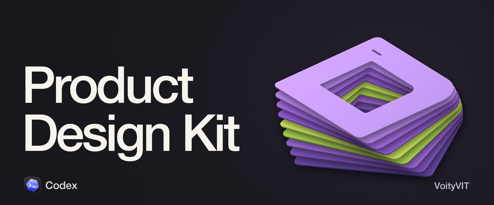
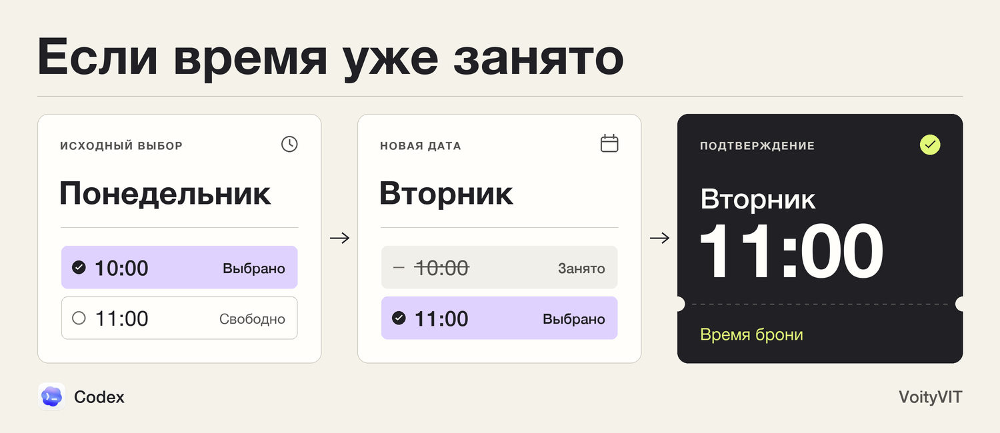

Комплект для работы с живыми макетами Figma в Codex. Можно попросить агента поправить один экземпляр, собрать переход между экранами или дать макет на пять независимых рецензий. Формат результата задаёт сама задача — от одной подписи до кликабельного прототипа.

**[Подключить к проекту](SETUP-PROMPT.md)** · [16 готовых запросов](design/RECIPES.md) · [Разобрать пример](PORTFOLIO.md)

## Что даёт ревью

В учебной спецификации бронирования требовалось показать новый день после смены даты. QA-агент нашёл пропущенный случай. Что произойдёт, если прежнее время на этот день уже занято?



Из замечания получилась проверка для прототипа. Выберите понедельник, 10:00. Перейдите на вторник, где 10:00 занято, и убедитесь, что прежний выбор сброшен. Выберите 11:00 и проверьте день и время в подтверждении. [Разбор учебного примера](PORTFOLIO.md)

## Как начать

Для правок подключите Figma к Codex и откройте файл с правом редактирования. Для первого визуального ревью достаточно скриншота.

1. Скачайте архив через **Code → Download ZIP** или выберите **product-design-kit.zip** в разделе **Releases**.
2. Откройте в Codex папку проекта, приложите архив и отправьте [запрос на подключение](SETUP-PROMPT.md).
3. Дайте ссылку на нужный фрейм и одну правку. Например, «На этом экране замени “Готово” на “Подтвердить время”. Проверь длинную подпись в мобильном размере и пришли ссылку на экземпляр».

<details>
<summary><strong>Установка из терминала</strong></summary>

Из распакованной папки выполните команды с путём к существующему проекту. Первая покажет план, вторая применит его.

```sh
python3 install.py "/путь/к/проекту"
python3 install.py "/путь/к/проекту" --apply
```

Требуется Python 3.8 или новее. Установщик сохраняет существующие инструкции и заполненные стандарты проекта. При конфликте версий он укажет файл до записи.

</details>

## Как выбрать исполнителей

| Задача | Кого подключить | Что получить |
| --- | --- | --- |
| Точечная правка | Основной агент | Ссылка на изменённый узел и проверка в контексте экрана |
| Новый сценарий | Специалисты по компонентам, UX, композиции или QA | Связанные состояния и проверка действия, возврата и сохранения выбора |
| Независимое ревью | Пять рецензентов по иерархии, поиску, бренду, чистоте UI и шаблонным ИИ-паттернам | Для каждой находки указаны место, помеха и одна конкретная правка |

[Поручения всех девяти ролей](SUBAGENTS.md) · [Что проверено в комплекте](VALIDATION.md)

## Настроить под свой проект

[Рабочие договорённости](design/WORKING-AGREEMENT.md) задают порядок итераций. В [карточке проекта](design/PROJECT-STANDARDS.md) хранятся его бренд, компоненты и одобренные образцы. [Навык Codex](.agents/skills/product-design-workflow/SKILL.md) связывает эти материалы с задачей и выбирает подходящих исполнителей.

<sub>[VoityVIT](https://github.com/VoityVitCod)</sub>
